# SPHEREx primer

SPHEREx is an all-sky survey that produces a low-resolution near-infrared spectrum of every 6.15 arcsec
pixel on the sky, not with a spectrograph but with filters whose passband changes with position on the
detector. An exposure is therefore an image in which each pixel sees a different, narrow wavelength; a
spectrum of one sky position is built from many exposures taken over the mission. This page collects the
instrument and survey facts that matter for using the data, with their sources. Everything measured in this
project rather than quoted is marked as such.

## Mission in one paragraph

SPHEREx is a NASA Medium Explorer launched on 2025-03-12 into a Sun-synchronous orbit (period 98 minutes,
mean local time of the ascending node 06:00). Science operations started on 2025-05-01 after seven weeks of
commissioning. The nominal mission is 25 months and consists of four complete all-sky surveys, two per year,
plus two deep fields near the ecliptic poles that are visited far more often. The survey covers 0.75-5.0 um
with resolving power R = 35-130 and 6.15 arcsec pixels, and yields of order 10^9 galaxy spectra and 10^8
stellar spectra.[^expsupp1][^korngut]

<figure markdown="span">
  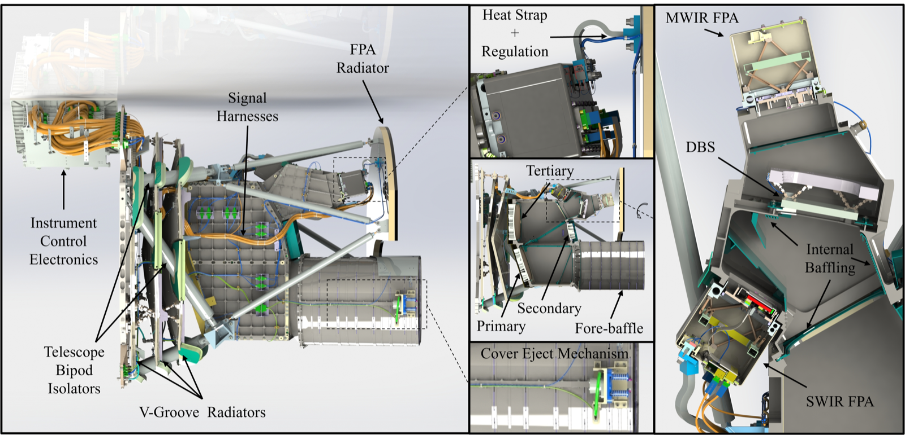{ width="760" }
  <figcaption>Credit: Figure 1 of Korngut et al. 2026 (arXiv:2603.29835).
  The instrument: an unobscured f/3 reflective triplet telescope with a 20 cm pupil behind three V-groove
  radiators and photon shields, feeding two focal-plane assemblies through a dichroic beamsplitter. The
  insets show the mid-wave focal plane with its thermal straps and the three filters mounted over the
  detector.</figcaption>
</figure>

## Telescope and focal planes

| Item | Value | Source |
|---|---|---|
| Telescope | all-aluminium free-form three-mirror anastigmat, f/3, 20 cm effective aperture, no diffraction spikes (unobscured) | instrument paper[^korngut] |
| Field of view | 3.5 deg x 11.3 deg, seen simultaneously by both focal planes | instrument paper |
| Dichroic beamsplitter | reflects below 2.42 um to the short-wave (SWIR) focal plane, transmits above it to the mid-wave (MWIR) focal plane | instrument paper |
| Detectors | six Teledyne H2RG HgCdTe arrays, 2048 x 2048 pixels of 18 um; 2040 x 2040 are active; three per focal plane; cut-off 2.6 um (SWIR) and 5.3 um (MWIR) | instrument paper, Explanatory Supplement |
| Operating temperatures | SWIR focal plane 62 K, MWIR 45 K, all passive cooling; drift below 2.5 mK over the survey | instrument paper |
| Pixel scale | 6.15 arcsec; the pixel solid angle varies from 0.989 to 1.017 times the nominal (6.15 arcsec)^2 across a detector because of distortion (measured from the Solid Angle Pixel Map, figure on the [reduction page](reduction_analysis.md#units-and-the-pixel-solid-angle)) | Explanatory Supplement; this project |
| Read noise, dark current | 18 e- (SWIR) and 15 e- (MWIR) correlated double sample; dark current below 0.05 e-/s; well depth of order 1e5 e- | instrument paper |
| Exposure | 118.19 s elapsed, 113.58 s integrated; the detector is sampled every 1.5349 s and the slope is fitted on board (sample-up-the-ramp) | Explanatory Supplement, live headers |

## Linear variable filters: wavelength is position

Each detector sits under a linear variable filter (LVF), an interference filter whose central wavelength
varies smoothly along one axis of the array. In band 1, for example, the central wavelength runs from 0.75 um
at one edge to 1.11 um at the other, and the whole 3.5 deg field of a band is a strip of 17 wavelength
"channels", each a 3.5 deg x 0.2 deg stripe on the sky.[^korngut] The progression is exponential in the
position along the filter, which keeps the resolving power constant within a band; because the filters were
coated on a rotationally symmetric machine, the iso-wavelength contours are circular arcs, the "smile".

<figure markdown="span">
  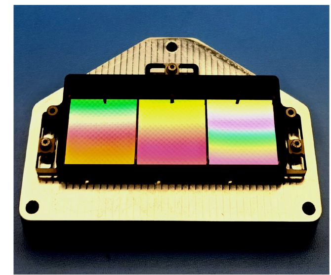{ width="420" }
  <figcaption>Credit: Figure 1 of Hui et al. 2026 (ApJS 284, 10; arXiv:2602.09139).
  The mid-wave focal-plane assembly: three H2RG detectors, each under its own LVF. The colour gradient is
  the interference coating; the passband wavelength increases monotonically along the vertical axis of
  each filter.</figcaption>
</figure>

<figure markdown="span">
  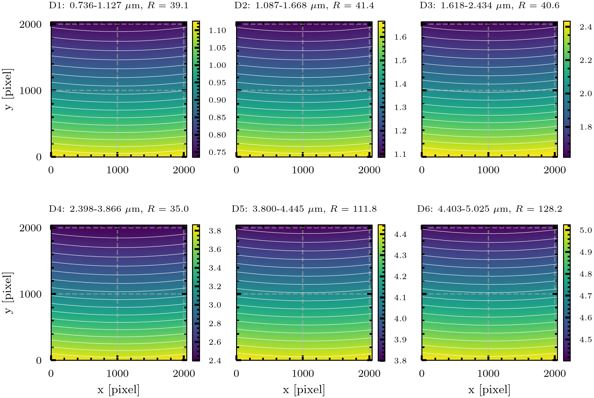{ width="820" }
  <figcaption>The per-pixel central wavelength (CWAVE, in um) of the six detectors from the DR1/QR3
  Spectral WCS calibration product, with iso-wavelength contours every 1/17 of the band. The curvature of
  the contours is the smile. The title of each panel gives the measured wavelength range and the median
  resolving power CWAVE / CBAND of the map. Made by <code>scripts/site_figures.py</code> from the files
  cached by spherex-retrieval.</figcaption>
</figure>

The spectral response of every one of the 24 million pixels was measured on the ground with a monochromator
scan of the assembled, cold instrument.[^hui] Three definitions from that paper are used throughout the
data products:

- the band centre of a pixel, CWAVE, is the wavelength at which the cumulative integral of its response
  reaches 50 % (their equation 3), which "captures the centroid of the non-Gaussian bandpass at shorter
  wavelengths";
- the bandwidth is the integral of the peak-normalised response, and the resolving power is
  R = CWAVE / bandwidth (their equation 4); the product CBAND = CWAVE / R is what the data files carry;
- the residual between the measured and the design central wavelengths is 0.26 % (1 sigma), with the largest
  residuals next to the 2.42 um dichroic transition, where the effective passbands of band 3 and band 4 are
  squeezed and shifted.[^korngut]

Out-of-band leakage is negligible for bands 3-6 and present at the percent level in bands 1 and 2, at
roughly 0.73, 0.87 and 1.3 times the band centre with peak amplitudes of about 0.8, 0.5 and 0.3 %; the
integrated out-of-band throughput stays below 5e-3.[^hui] This is why the bright He I 1.083 um airglow line
produces weak features near 0.84 um in band 1 and near 1.25 and 1.49 um in band 2 (see the
[reduction page](reduction_analysis.md#atmospheric-emission)).

<figure markdown="span">
  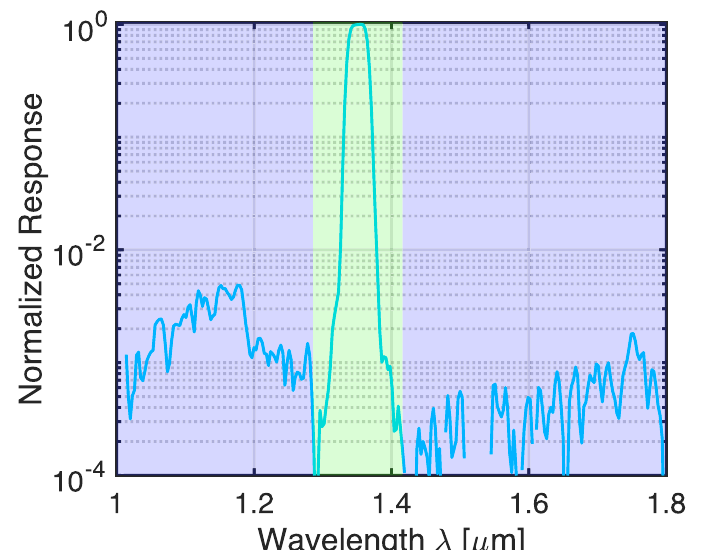{ width="360" }
  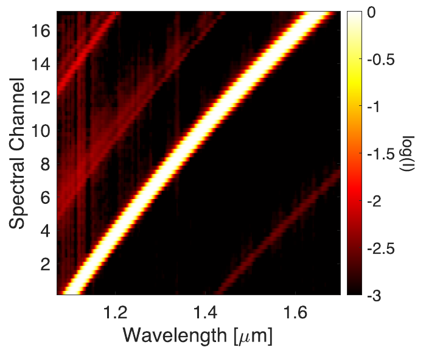{ width="360" }
  <figcaption>Credit: Figures 12 and 20 of Hui et al. 2026. Left: the measured
  spectral response of one band-2 pixel, with the in-band scan in green and the much weaker out-of-band
  response in purple. Right: the response of band 2 as a function of detector position (labelled by the
  nominal channel): the bright diagonal is the LVF progression, the three faint diagonals are the
  out-of-band leakage features.</figcaption>
</figure>

## The six bands

Design values from the Explanatory Supplement[^expsupp1], measured values from the DR1/QR3 Spectral WCS maps
(this project, the figure above):

| Band | Design range (um) | Design R | Measured CWAVE range (um) | Measured median R | Focal plane |
|---|---|---|---|---|---|
| D1 | 0.744-1.116 | 39 | 0.736-1.127 | 39.1 | SWIR |
| D2 | 1.099-1.651 | 41 | 1.087-1.668 | 41.4 | SWIR |
| D3 | 1.636-2.421 | 41 | 1.618-2.434 | 40.6 | SWIR |
| D4 | 2.423-3.822 | 35 | 2.398-3.866 | 35.0 | MWIR |
| D5 | 3.809-4.420 | 112 | 3.800-4.445 | 111.8 | MWIR |
| D6 | 4.412-5.002 | 128 | 4.403-5.025 | 128.2 | MWIR |

Adjacent bands overlap by about a quarter of a channel by design, so that the spectrum is continuous.
At the band 3/4 boundary the dichroic edge sits inside the overlap; pixels whose throughput falls below 50 %
are flagged DICHROIC and in our data every exposure with CWAVE between 2.417 and 2.426 um had the target
pixels flagged (measured on 2,225 exposures; see the [reduction page](reduction_analysis.md#the-dichroic-boundary)).

<figure markdown="span">
  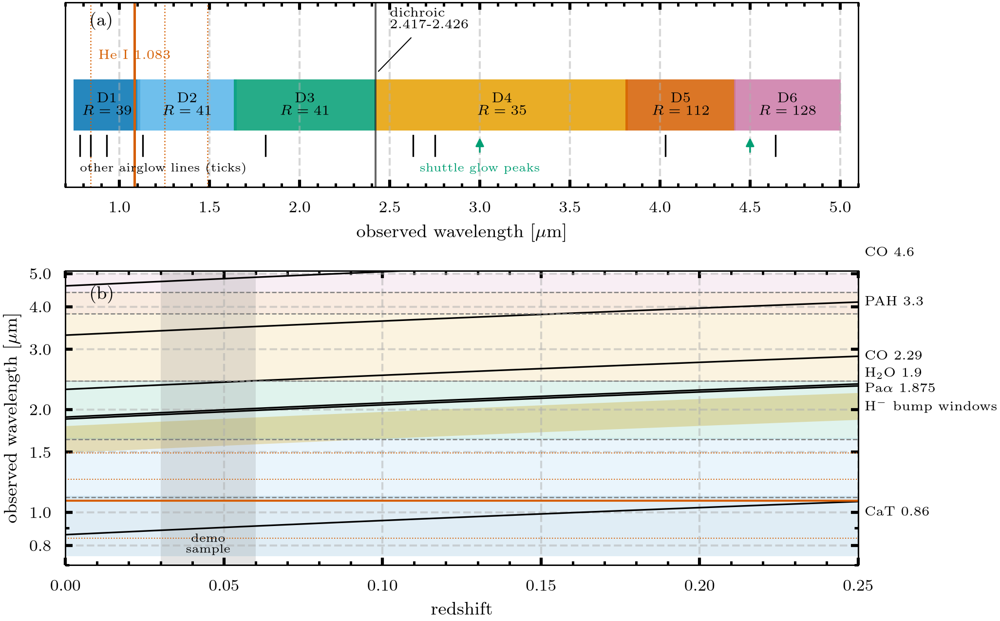{ width="820" }
  <figcaption>(a) The six bands with their resolving powers, the dichroic gap, the He I 1.083 um airglow line
  (solid) and its leak features (dotted), the other atmospheric lines listed in the Explanatory Supplement
  (ticks) and the shuttle-glow peaks. (b) The observed wavelength of rest-frame features as a function of
  redshift, against the bands (shaded), the detector boundaries (dashed) and the airglow lines. The grey
  stripe is the redshift range of the SED demonstration. Made by <code>scripts/site_figures.py</code>.</figcaption>
</figure>

### Spectral channels versus per-pixel wavelengths

For survey planning each band is divided into 17 nominal channels, 102 in all, by logarithmic spacing of the
band's measured wavelength range.[^cukierman] The Spectral Channels calibration product assigns every pixel to
a channel and tabulates each channel's central wavelength, limits, bandwidth and R; the IRSA tools and every
published spectrum use this 102-point grid. The channels are a bookkeeping grid, not a wavelength solution:
the wavelength at which a source is measured in a given exposure is the CWAVE of the pixel it lands on, and
adjacent nominal channels overlap by up to 0.018 um (measured from the channel table; see
[lessons](lessons.md)). Bands 5 and 6 have about three times finer sampling per channel than bands 1-4.

<figure markdown="span">
  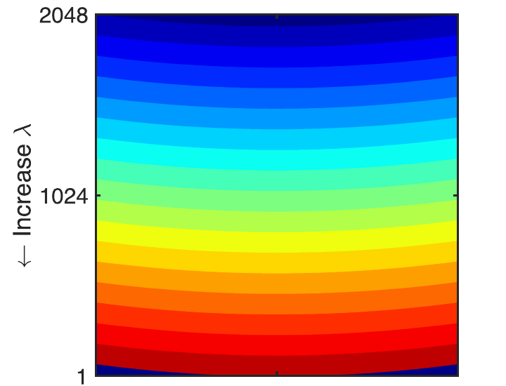{ width="380" }
  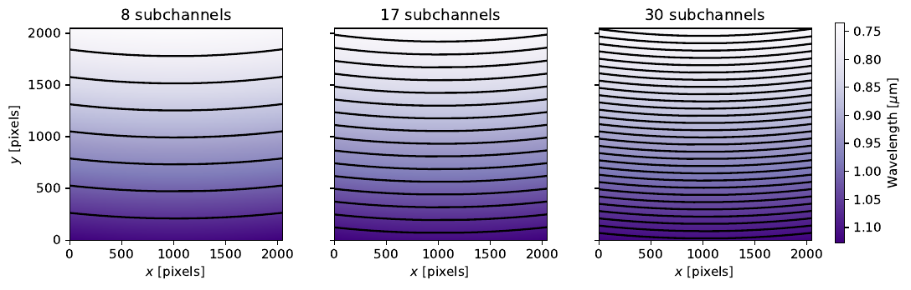{ width="420" }
  <figcaption>Credit: Figure 2 of Hui et al. 2026 (left) and a figure of Cukierman et
  al. 2026 (ApJS 286, 22; arXiv:2603.25790, right). The 17-channel layout of one detector, defined
  geometrically for survey planning, and the logarithmic channel definition for array 1. Pixels at the
  curved band edges fall outside the nominal layout but are optically active.</figcaption>
</figure>

## The point spread function

The pixels deliberately undersample the optical PSF: in a background-limited survey the point-source
sensitivity improves when the light is concentrated in as few pixels as possible. The instrument paper
therefore does not quote a FWHM but the effective number of pixels N_eff = 1 / sum(p_i^2), where p_i is the
fraction of the flux in pixel i; the point-source noise scales as the square root of N_eff.[^korngut] The
pipeline delivers an empirical PSF (ePSF) per detector zone, built from stars in the Anderson and King
formalism on a 5x oversampled 33 x 33 grid with unit integral; the zone tables carry the mean N_eff and the
number of stars used.[^expsupp4]

<figure markdown="span">
  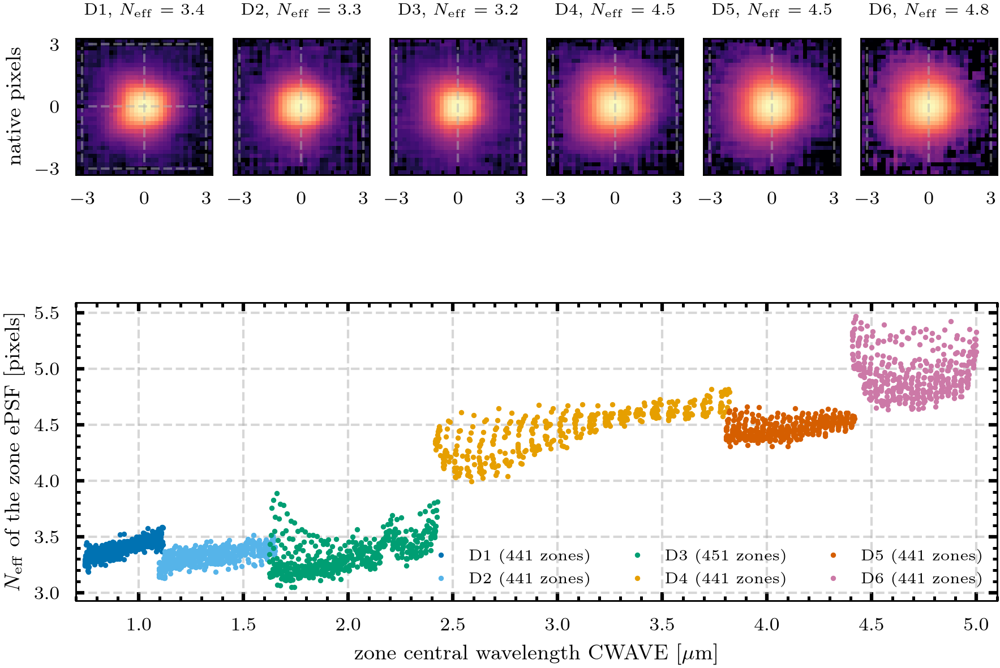{ width="820" }
  <figcaption>Top: the central-zone ePSF of each detector (logarithmic stretch over 3.5 decades, axes in
  native pixels), from the DR1/QR3 ePSF calibration files. Bottom: the mean N_eff of every ePSF zone
  against the zone's central wavelength. The medians over zones are 3.4, 3.3, 3.3, 4.5, 4.5 and 4.9 pixels
  for D1-D6 (measured). Made by <code>scripts/site_figures.py</code>.</figcaption>
</figure>

<figure markdown="span">
  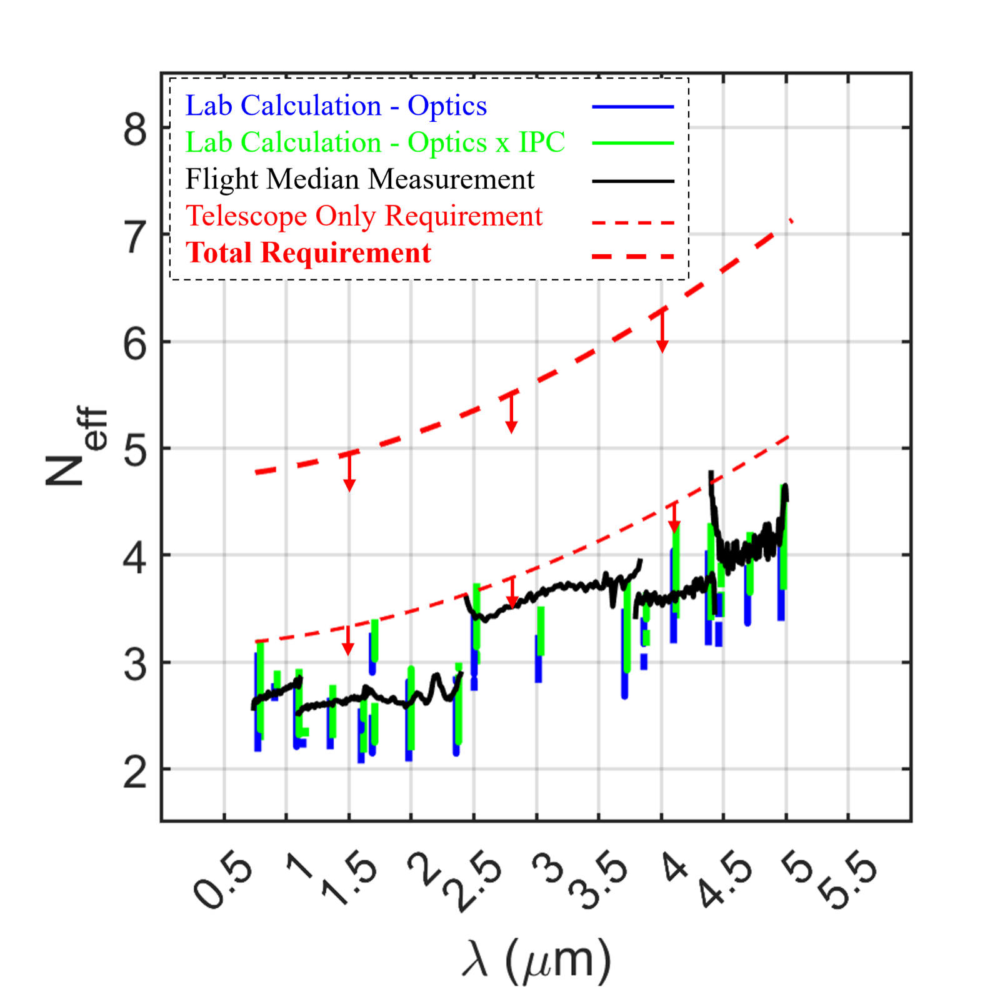{ width="420" }
  <figcaption>Credit: Figure 13 of Korngut et al. 2026. N_eff from the optical
  model with and without inter-pixel capacitance, and the in-flight measurement from 1.1 million isolated
  stars. Our zone medians above agree with the flight curve.</figcaption>
</figure>

Two consequences for galaxy photometry: the header keyword PSF_FWHM is a per-image median in arcsec that
differs between the QR2 optical PSF (5.2 arcsec in one D3 file) and the QR3 ePSF (7.4 arcsec in one D3
file), so it must not be compared across releases; and a resolved galaxy a few arcsec across is only
semi-resolved at 6.15 arcsec pixels with N_eff of 3-5, which is why point-source fits lose 20-70 % of the
light of typical SDSS galaxies (see the [SED page](sed_extraction.md)).

## Backgrounds and sensitivity

The zodiacal light dominates the photocurrent in every exposure and its photon noise is the dominant noise
term at all wavelengths; read noise is sub-dominant.[^korngut] Above it sit the atmospheric emission lines
(He I 1.083 um in every exposure, auroral lines, others), shuttle glow near 3.0 and 4.5 um, and Earthshine;
all of these are described with their mitigations on the [reduction page](reduction_analysis.md#backgrounds).

<figure markdown="span">
  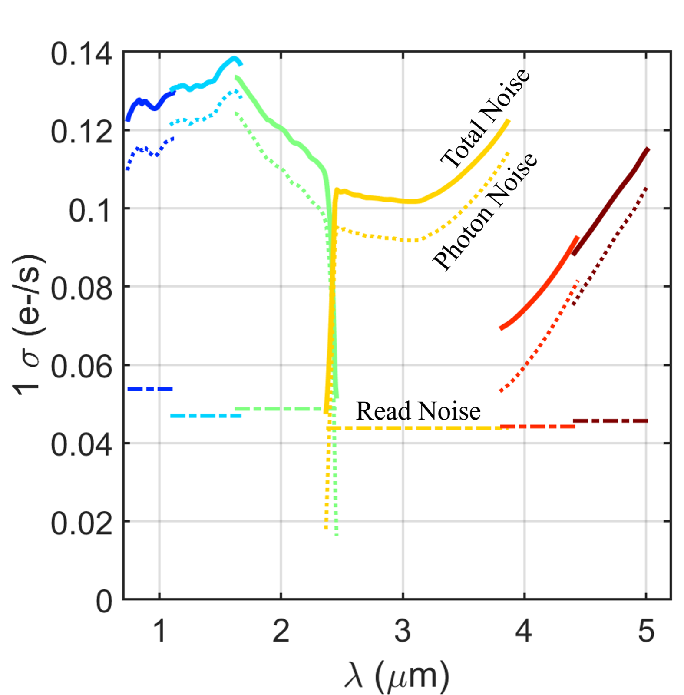{ width="400" }
  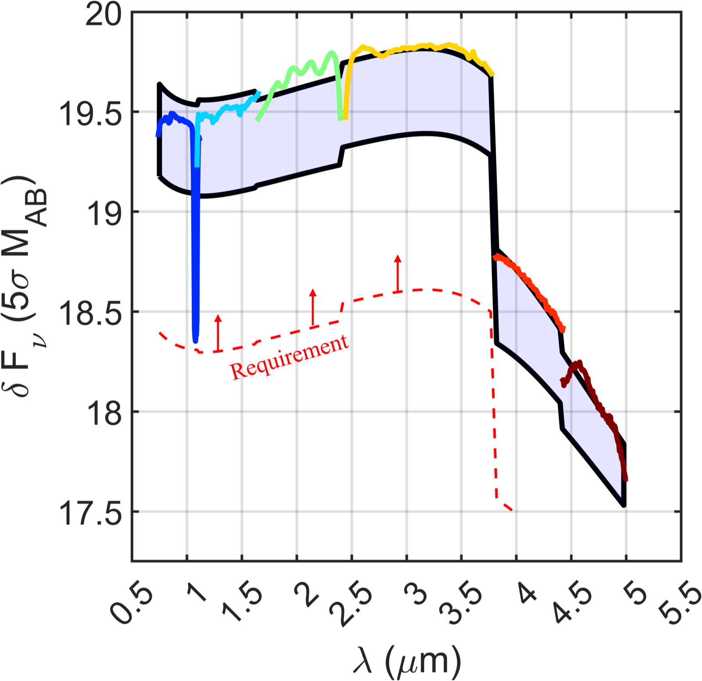{ width="400" }
  <figcaption>Credit: Figures 7 and 25 of Korngut et al. 2026. Left: the white
  noise budget of one 118 s exposure, zodiacal photon noise against read noise. Right: the projected all-sky
  point-source sensitivity at the end of the four-survey mission, assuming four observations per
  wavelength, with the 2018 proposal projection for comparison; the only shortfall is the channel
  contaminated by the He I airglow line.</figcaption>
</figure>

Per-exposure depths in physical units are not tabulated in the instrument paper. Rustamkulov et al. 2026
quote 5 sigma point-source limits of about 19.5 AB over 0.75-3.8 um and 17.5-18.5 AB over 3.8-5 um per
exposure[^rustamkulov], and the archive's TAP table carries a per-exposure `metrics_maglimit`. For the
z = 14.3-15.7 (SDSS model magnitude) galaxies of our demonstration the per-exposure signal-to-noise ratio of
the forced model flux is 40-90 at 1-3.5 um and about 10 at 5 um (measured, figure on the
[reduction page](reduction_analysis.md#backgrounds)).

## How the sky is surveyed

<figure markdown="span">
  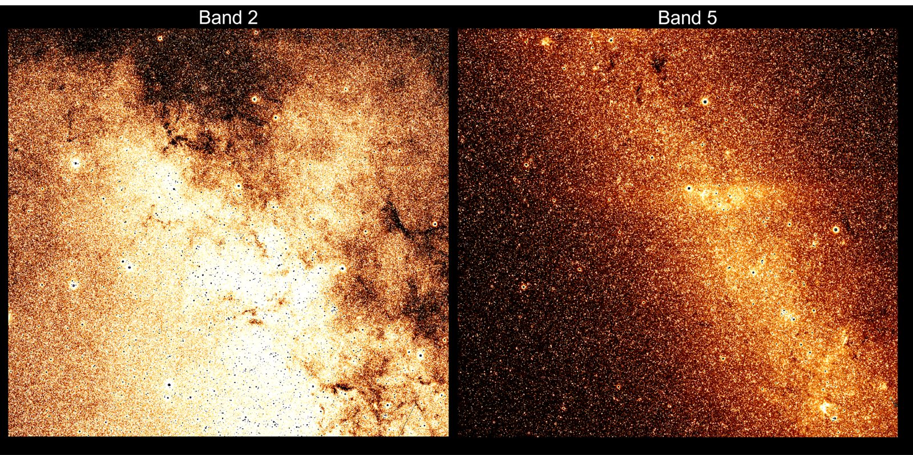{ width="760" }
  <figcaption>Credit: Figure 18 of Korngut et al. 2026. Simultaneous raw images
  from band 2 (left) and band 5 (right) during the first practice survey, crossing the Galactic plane. The
  horizontal banding is the LVF: each row of the array sees a different wavelength, so emission lines and
  the zodiacal spectrum appear as stripes.</figcaption>
</figure>

The Survey Planning Software schedules pointings on the fly, honouring Sun, Earth, Moon and shuttle-glow
avoidance (local zenith angle below 42 deg, ram angle below 70 deg).[^korngut][^expsupp1] The all-sky
survey is organised in target groups of 17 pointings at fixed ecliptic longitude, stepped in ecliptic
latitude by one channel width, so that completing a group covers a strip of sky in every one of the 17
channels of a band. The spacecraft position angle alternates between 0 and 180 deg on the ascending and
descending halves of each orbit, and this angle together with the mission time defines the four surveys:
Surveys 1 and 2 (position angle 0 and 180) in the first 12.5 months, Surveys 3 and 4 in the second, with the
year-2 target list shifted by half a channel so that the accumulated spectrum is Nyquist sampled. The two
deep fields use a separate, heavily overlapping tiling.[^expsupp1]

What this means for one galaxy outside the deep fields: in each survey it is observed roughly once in each of
the 102 channels, in six separate exposures per pointing (one per detector), and each exposure samples it at
the CWAVE of the pixel it happens to fall on. Repeat measurements at nearly the same wavelength come from
different surveys and different detector positions.

<figure markdown="span">
  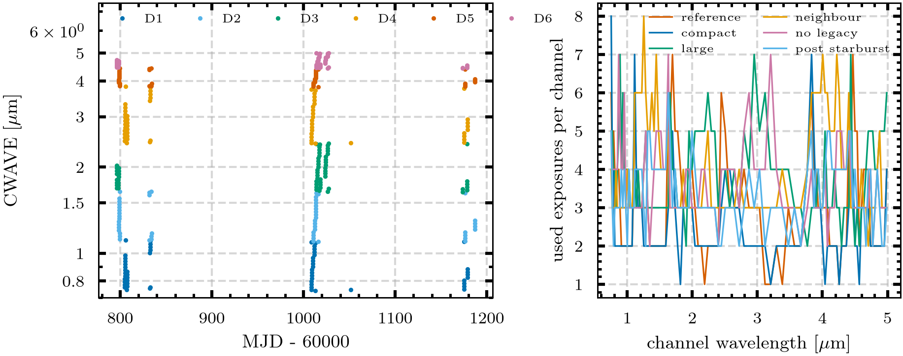{ width="820" }
  <figcaption>(a) Every DR1 + QR3 wide-survey exposure of the demonstration's reference galaxy
  (RA 168.1, Dec +12.1, ecliptic latitude +6 deg): the central wavelength of the pixel it fell on against
  time, coloured by detector. Three passes separated by more than 30 days fall between MJD 60796
  (2025-05-01) and 61187 (2026-05-27), 223 distinct epochs in all. (b) The number of exposures that
  survived our quality screening in each of the 102 channels for the six demonstration galaxies: 1-8 per
  channel, median 2-4 (measured). Made by <code>scripts/site_figures.py</code>.</figcaption>
</figure>

<figure markdown="span">
  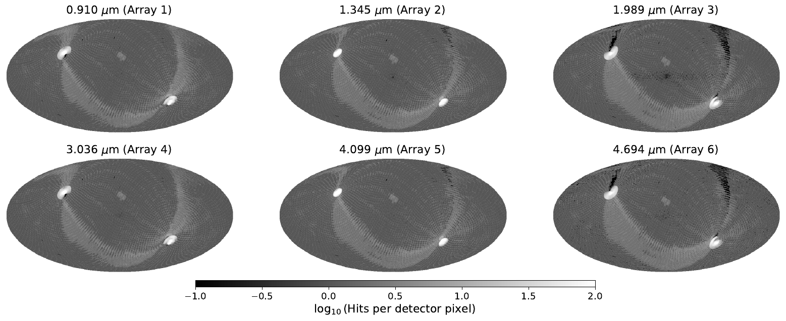{ width="760" }
  <figcaption>Credit: Cukierman et al. 2026, hit-count panel. The number of
  exposures contributing to each pixel of a regional mosaic after the first survey: coverage is set by the
  scan pattern and is denser towards the ecliptic poles.</figcaption>
</figure>

Observation identifiers encode the planning period: `2026W31_1B_0205_1` is week 31 of 2026, first half of the
week, plan version B, large slew 0205, small slew 1; the first science plan was `2025W17_4B`.[^expsupp1]

## Imaging, spectroscopy, or neither

It helps to hold three statements at once:

1. Each exposure is an image: 2040 x 2040 pixels of 6.15 arcsec, a full astrometric solution, a PSF, and the
   usual image artefacts (cosmic rays, persistence, ghosts, satellite streaks).
2. Each pixel of that image is a narrow-band measurement (R = 35-130) at its own wavelength, and the
   wavelength changes smoothly across the image. A resolved galaxy is therefore observed at slightly
   different wavelengths across its own extent in a single exposure, and sky lines appear as curved stripes.
3. A spectrum of a source exists only after many exposures from different pointings are combined, and its
   sampling in wavelength is irregular: it is set by where the source landed on the detectors, not by a
   fixed grid.

Mosaics and data cubes (the all-sky cube of DR1, the IRSA Mosaic Tool) hide the third point by binning
exposures into the 102 nominal channels; forced photometry on the individual exposures keeps it and must
carry the per-exposure wavelength and bandwidth through the analysis. The [reduction page](reduction_analysis.md)
describes the products this requires.

## Data products in brief

| Level | Product | Status (2026-11-14) |
|---|---|---|
| 2 | spectral images: one multi-extension FITS file per detector per pointing with IMAGE (MJy/sr), FLAGS, VARIANCE, ZODI, ePSF and a wavelength lookup table | DR1 (reprocessed year 1) and QR3 (weekly) at IRSA |
| 2 | calibration products: per-pixel CWAVE/CBAND maps, Spectral Channels, Solid Angle Pixel Map, ePSF files, atmospheric templates, gain, flux corrections | with each release |
| 3 | forced photometry catalogues at Reference Catalog positions; all-sky cube | all-sky visualisation cube in DR1; no forced-photometry catalogue yet |
| 4 | science products (redshifts, maps) | planned |

See [Data access](data_access.md) for the releases, services and the lessons learned while using them.

[^expsupp1]: SPHEREx Explanatory Supplement v2.0 (2026-08-25), sections 1.1-1.4 (mission, payload, survey
    strategy); our [reading note](references/irsa/spherex_explanatory_supplement_v2.0.md).
[^expsupp4]: Explanatory Supplement v2.0, sections 4.1.2 and 4.2.3 (ePSF models and PSF measurement).
[^korngut]: Korngut et al. 2026, "The SPHEREx Instrument: Calibration, testing and performance measurements
    of the NIR spectroscopic surveyor from the laboratory to in-orbit commissioning", arXiv:2603.29835;
    our [reading note](references/papers/paper_instrument_2603.29835.md). Optical design, LVFs and band
    table in their sections 2-3; N_eff in section 5; Earthshine, shuttle glow and the He I line in section 9.
[^hui]: Hui et al. 2026, "Spectral response of SPHEREx", ApJS 284, 10, arXiv:2602.09139; definitions in
    their section 2 (equations 3 and 4), out-of-band response in section 6.2.
[^cukierman]: Cukierman et al. 2026, "Spectral Map Making with SPHEREx", ApJS 286, 22, arXiv:2603.25790,
    section 4.1 (channel definitions); our [reading note](references/papers/paper_mapmaking_2603.25790.md).
[^rustamkulov]: Rustamkulov et al. 2026, arXiv:2607.00543, as summarised in our
    [reading note](references/papers/paper_ref_2607.00543.md).
