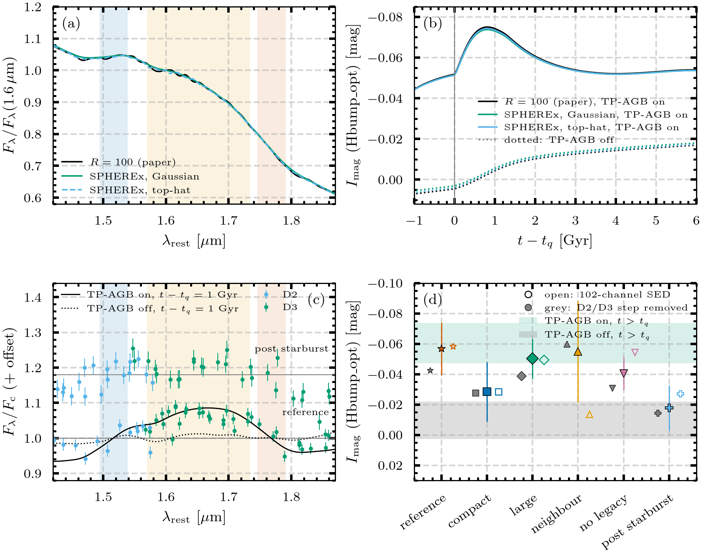

# Spectral index measurement

Can a spectral index defined for spectra be measured from a SPHEREx SED? The SED of a galaxy from forced
photometry is a set of flux densities at irregular wavelengths, each with its own bandwidth of about
lambda / 40, with a handful of samples per nominal channel and detector boundaries at fixed observed
wavelengths. This page sets out what that does to an index, using the 1.6 um H-minus bump index as the
worked example; the full study is in the [feasibility report](reports/hminus_bump_feasibility.md).

## What an index sees in SPHEREx data

Three properties of the data enter any index:

- Resolving power. Each sample is the source spectrum convolved with the pixel's response (equivalent width
  CWAVE / R; R = 41.4 in bands 1-3, 35 in band 4, 112 and 128 in bands 5-6; the profile shape is not
  tabulated, see the [primer](primer.md#linear-variable-filters-wavelength-is-position)). Narrow lines are
  diluted by the bandwidth; broad features (0.1 um and wider) are barely affected. Absorption-line indices
  with 10-20 A windows (Lick, H-delta) are out of reach; continuum-break and bump indices are not.
- Sampling. With the current coverage (DR1 + QR3, roughly two surveys) a galaxy outside the deep fields has
  1-8 usable exposures per nominal channel, median 2-4 ([primer figure](primer.md#how-the-sky-is-surveyed)),
  placed at irregular wavelengths. A 0.045 um index sideband therefore holds only 2-7 samples; the error
  of a band mean is set by that count, and the mean itself is biased when the samples cluster at one end of
  the window.
- Detector boundaries. The five boundaries (1.1055, 1.6375, 2.4215, 3.814, 4.414 um observed) and the
  DICHROIC gap at 2.417-2.426 um fall at fixed observed wavelengths, so for a given redshift they land at
  fixed rest wavelengths inside or between the index windows. A detector-to-detector flux step of 1 % is
  then an index error of a few thousandths of a magnitude that does not average down with more galaxies
  ([band layout figure](primer.md#the-six-bands), panel b).

The resolution question is answered once per index by degrading model spectra; the other two must be
answered on the real sampling of the target sample.

## The worked example: the 1.6 um H-minus bump

The H-bump paper of this group[^hbump] defines Hbump_opt with a blue sideband at 1.494-1.539 um, a feature
band at 1.570-1.734 um and a red sideband at 1.746-1.791 um (rest, vacuum); the index is
I_mag = -2.5 log10 of the mean of F_lambda over its straight-line pseudo-continuum in the feature band, so a
stronger bump is more negative. In the paper's FSPS mocks the rapid-quenching class has a median index of
-0.075 mag with TP-AGB stars on and -0.004 mag with them off, the transient excursion along one quenching
track is 0.006-0.023 mag, and the classifier gain requires a precision of 0.005-0.010 mag; at 0.020 mag the
gain is small. The paper measured the index at an instrumental R = 100.

<figure markdown="span">
  { width="820" }
  <figcaption>Figure 8. (a) A TP-AGB-on FSPS spectrum 1 Gyr after quenching at the paper's R = 100 and
  degraded to the SPHEREx resolving power with a Gaussian and a top-hat of equivalent width lambda / 41.4;
  shaded: the Hbump_opt windows. (b) Hbump_opt along the t_q = 3 Gyr, tau_q = 0.3 Gyr solar track for the
  three kernels; solid TP-AGB on, dotted off. (c) Exposures of the reference galaxy and of the
  post-starburst galaxy (offset +0.18) divided by their pseudo-continuum, D2 and D3 in the detector colours,
  with the two models at SPHEREx resolution. (d) Hbump_opt of the six galaxies: filled, from the exposures
  with bootstrap errors; open, from the 102-channel SED; grey, after removing each galaxy's measured D2/D3
  ratio; bands, the model ranges after quenching. Script: <code>scripts/sed_demo/hminus_bump_feasibility.py</code>.</figcaption>
</figure>

### Resolution: not a limitation

Over 344 FSPS single-stellar-population spectra (ages 0.1-12.6 Gyr, four metallicities, TP-AGB on and off)
degrading from R = 100 to the SPHEREx kernels changes Hbump_opt by -0.0006 mag (median) with extremes of
-0.002 and +0.002, whether the kernel is a Gaussian or a top-hat of equal equivalent width or a Gaussian
with FWHM = lambda / R; the slope of index(SPHEREx) against index(R = 100) is 0.97-0.98. The on/off
contrast 1 Gyr after quenching stays at 0.067 mag (0.095 with the wider Lu et al. 2026 windows, 0.102 with
the narrow Verro et al. 2022 windows). The 0.045 um sidebands are 1.2 resolution elements wide, which is
enough for a feature 0.3 um across.

### Sampling: the statistical limit today

Measured on the six demonstration galaxies (model flux, dereddened, screened exposures; errors from
bootstrapping the exposures inside each window):

| Galaxy | z | Exposures blue / feature / red | I_mag from exposures | I_mag from the 102 channels | Simulated scatter with the real sampling |
|---|---|---|---|---|---|
| reference | 0.046 | 2 / 25 / 4 | -0.057 +- 0.017 | -0.058 +- 0.019 | 0.010 |
| compact | 0.058 | 4 / 12 / 5 | -0.028 +- 0.020 | -0.028 +- 0.011 | 0.010 |
| large | 0.033 | 4 / 18 / 3 | -0.050 +- 0.013 | -0.050 +- 0.010 | 0.007 |
| neighbour | 0.033 | 4 / 16 / 3 | -0.055 +- 0.033 | -0.014 +- 0.027 | 0.032 |
| no legacy | 0.052 | 7 / 13 / 3 | -0.040 +- 0.011 | -0.054 +- 0.007 | 0.009 |
| post-starburst | 0.052 | 5 / 15 / 3 | -0.018 +- 0.015 | -0.027 +- 0.014 | 0.011 |

One galaxy gives 0.011-0.020 mag today: the paper's "small gain" regime. The on/off contrast is detectable
per galaxy at 3-6 sigma; the quenching-time excursion is not. The error is set by the 2-7 exposures per
sideband and falls as the square root of their number: a stack of 10-20 galaxies, or the four-survey
mission, reaches 0.005 mag. The wider Lu et al. windows (6-13 and 10-17 sideband exposures) give
0.011-0.019 mag; the Verro et al. windows (0.02 um sidebands) hold 0-3 exposures and cannot be used with
this sampling.

### The D2/D3 boundary: the systematic limit

For 0 < z < 0.096 the 1.6375 um boundary falls inside the index windows (rest 1.547-1.585 um for the demo
sample, between the blue sideband and the feature band). A 1 % detector step moves Hbump_opt by 0.003-0.007
mag (0.003-0.005 for the Lu et al. windows). The per-galaxy model-flux steps measured in the demo (0-3 %,
D3 brighter) shift the index by up to 0.015 mag, the size of the signal, while isolated stars constrain the
calibration step only to +-1.3 %. Whether the galaxy steps are calibration, the Sersic model's response to
the different ePSFs of D2 and D3, or real spectral curvature that the boundary fit's quadratic did not
absorb, is the open D2/D3 question of the [SED page](sed_extraction.md#questions-open-after-the-demonstration).
Until it is settled at the 0.3 % level the index carries a 0.005-0.015 mag systematic per galaxy that a
stack does not remove.

### The estimator

Band means over irregularly placed exposures are biased by up to 0.008 mag when the exposures cluster at one
end of a window (two of the six galaxies), and the channel-based estimator disagrees with the exposure
estimator by 0.014 and 0.04 mag for two galaxies. A forward model fitted to all 40-60 exposures in
1.4-2.0 um, with a smooth continuum plus a bump template (or FSPS spectra directly) and each exposure
weighted by its bandpass, removes the sampling bias and uses the feature-band exposures to constrain the
continuum as well. The simulation in the feasibility script, which samples degraded model spectra at the
real exposure wavelengths with the measured exposure scatter, is the template for validating any such
estimator.

### What the six galaxies show

Five of the six have I_mag between -0.03 and -0.06 mag, inside the TP-AGB-on range of the quenching track
and below the TP-AGB-off range; the post-starburst galaxy has the weakest bump, -0.018 +- 0.015 (both
estimators), the opposite of the TP-AGB-on expectation 0.5-1 Gyr after quenching. With 0.015 mag errors,
the unresolved D2/D3 term and a single solar-metallicity comparison track this is not yet a measurement
of anything; but panel (c) of figure 8 shows the reference galaxy's exposures 5-8 % above its
pseudo-continuum across the whole feature band, like the TP-AGB-on model, so the dynamic range is there.

## Rules for defining an index on SPHEREx SEDs

1. Place the windows in the rest frame of the target sample and check, with panel (b) of the
   [band layout figure](primer.md#the-six-bands), where the detector boundaries, the dichroic gap and the
   He I line and its leaks (0.84, 1.083, 1.25, 1.49 um observed) fall. A boundary inside a window costs a
   calibration term; a boundary between the sidebands and the feature is the worst case.
2. Count the exposures per window for the real sample before trusting an error; sidebands narrower than
   about 0.05 um are not usable with two surveys.
3. Test the resolution once with degraded model spectra, for a Gaussian and a top-hat of equal equivalent
   width, and quote the difference.
4. Prefer a forward-model estimator over band means, and validate it on model spectra sampled at the real
   exposure wavelengths with the measured exposure scatter.
5. Carry each exposure's bandwidth and the detector-step uncertainty into the index error; the latter does
   not average down in a stack.

## Next steps

- Settle the D2/D3 step at the 0.3 % level (hundreds of field stars, or the point-source control per ePSF
  zone), or move the index sample to z > 0.1 where the whole Hbump_opt index sits on D3.
- Implement the forward-model estimator and validate it on injected FSPS spectra.
- Re-measure when Surveys 3 and 4 arrive (half-channel offset, roughly twice the sampling).

[^hbump]: "The 1.6 um H-minus bump as a diagnostic of TP-AGB contributions and recent quenching. I. Insights
    from stellar population models" (in preparation); the index code and the cached FSPS products are in
    the group's `luandun/stellar_pop/fsps_agb` project, read only from here. Window definitions follow Verro
    et al. 2022 and Lu et al. 2026 as tabulated there.
